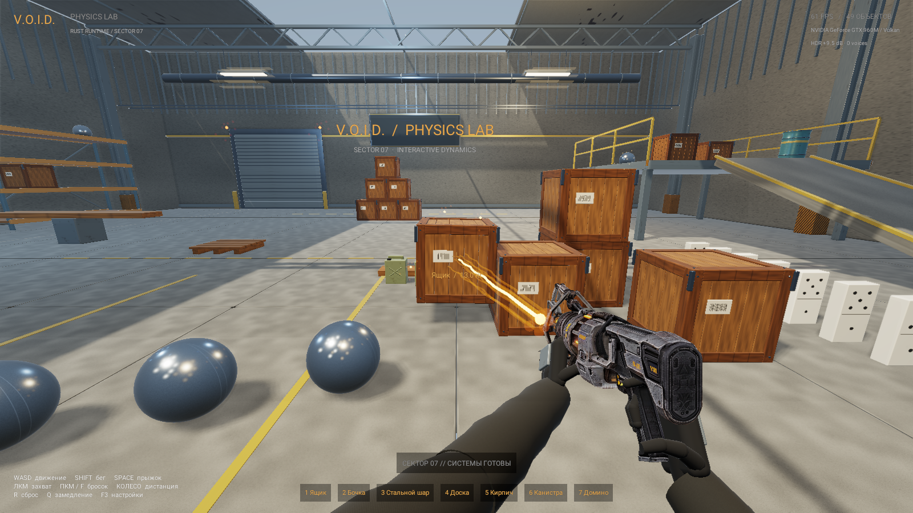

# V.O.I.D. Engine

**Virtual Objects & Interactive Dynamics** — native Rust engine and an interactive
industrial physics laboratory for Windows.

The **0.2 Rust runtime** lives in `crates/void-engine` and `crates/void-demo`.
Rendering, window/input, physics, audio, the scene and the first-person rig run
from a Cargo workspace.




## Build and run

Requirements: stable Rust (MSVC toolchain), Visual Studio Build Tools with the
Windows SDK and MSVC linker, and a DX12 or Vulkan GPU driver.

```powershell
cargo build --release --locked
cargo run --release --locked -p void-demo -- --rhi=dx12
cargo run --release --locked -p void-demo -- --rhi=vulkan
```

Executable: `target/release/void_demo.exe`.

```powershell
# Package the executable and assets into build/bin/Release:
.\tools\build-rust.ps1
.\build\bin\Release\void_demo.exe --rhi=dx12 --autostart
```

Assets are found beside the executable, in a repository ancestor, or through
`VOID_ASSETS` (an absolute path to `assets`). Settings persist as `settings.toml`
beside the executable. CLI resolution/vsync options override saved settings.

## What changed

- **Rust workspace:** reusable engine library, separate game binary, pinned
  `Cargo.lock`; `wgpu` for native DX12/Vulkan, `winit` for input/windowing,
  Rapier for rigid bodies and `rodio` for device output.
- **Lighting:** linear HDR intermediate target, GGX/Cook–Torrance shading,
  Fresnel, rough-metal environment approximation, directional key and four
  local lights, 2048² PCF shadows, depth-based contact shading, restrained
  bloom, lightweight edge smoothing, ACES tone mapping and sRGB output.
- **Materials:** seamless colour/roughness and normal atlases, mip chains and
  anisotropic filtering for concrete, timber, steel, chipped paint, rubber,
  brick and safety stripes.
- **Props:** bevelled silhouettes, crates assembled from individual boards,
  nails, corner protectors and shipping labels; profiled drums with rolled
  rims, reinforcing ribs and caps; slatted pallets with compound collision;
  jerry cans with handles and pressed ribs; domino pips and traffic cones.
- **Lab:** poured-concrete slabs, steel columns and triangulated trusses,
  skylight opening, hanging lamps, loading door, ventilation, conduits,
  braced shelving, cargo deck, complete safety railing and ramp.
- **Hands/tool:** one camera-space rig for the tool and wrists, 56 cm GLB
  scale, adult-sized palms and three-joint fingers, grip poses, elbow IK,
  tapered sleeves and cuffs. Separate 62° viewmodel projection keeps weapon
  proportions stable while the world FOV changes; its own depth buffer
  prevents walls from cutting through it. Sway, breathing, walk bob, grip
  tightening and recoil move the whole assembly together.
- **Interaction:** 60 Hz fixed physics, CCD, sleeping, capsule player,
  jumping, spring grab, collision filtering while held, throw/shove,
  distance adjustment, reset, bounded spawning and slow motion.
- **Sound/UI:** spatial, bounded 32-voice float mixer with loudness-following
  HDR gain, soft limiter and slow-motion filtering; existing WAV effects;
  Cyrillic-capable scalable UI, menu, pause, HUD and live settings.

The environment reflection and contact shading are lightweight approximations;
the renderer does not claim ray tracing, full GI or production PBR assets.

## Controls

| Input | Action |
| --- | --- |
| WASD / Shift / Space | Move / sprint / jump |
| Mouse | Look |
| Hold LMB | Grab; release to drop |
| RMB or F | Shove / throw |
| Wheel | Hold distance |
| 1–7 | Spawn crate, drum, steel ball, plank, brick, jerry can, domino |
| G | Spawn a varied prop |
| R / Q / M | Reset / slow motion ×0.28 / mute |
| [ / ] | World FOV |
| , / . | Eye height |
| F3 / Esc | Settings / pause |

## Verification and captures

```powershell
cargo fmt --all -- --check
cargo clippy --workspace --all-targets --locked -- -D warnings
cargo test --workspace --locked
cargo run --release --locked -p void-demo -- --selftest

# GPU validation, deterministic camera, automatic exit and PNG readback:
.\target\release\void_demo.exe --rhi=dx12 --autostart --smoke=90 --screenshot=docs/rust-game.png
.\target\release\void_demo.exe --rhi=vulkan --showcase --smoke=90 --screenshot=docs/rust-grab.png
.\target\release\void_demo.exe --rhi=dx12 --benchmark=300 --novsync
```

`--selftest` checks gravity/settling, picking, spring movement, throwing and
the shipped GLB/embedded texture without opening a window. Unit tests also
cover collision-filter restoration, audio limiting/panning and IK bone lengths.
`--smoke=N` renders N frames and exits; screenshots include the real GPU scene
and UI. Benchmark output names the actual adapter and reports average FPS,
1% low and p95 frame time after 30 warm-up frames.

Other flags: `--adapter=N`, `--width=N`, `--height=N`, `--fullscreen`,
`--settings`, `--validation`, `--no-prompt`, `--help`. The graphics backend can
be `dx12`, `vulkan` or `auto`; `auto` requests a high-performance adapter.

### Measured Rust build

Short local runs on NVIDIA GeForce GTX 960M, 1600×900, VSync off, default
graphics, 180 measured frames after 30 warm-up frames (2026-11-10):

| Backend | Average | 1% low | p95 frame time |
| --- | ---: | ---: | ---: |
| DX12 | 95.9 FPS | 47.5 FPS | 20.24 ms |
| Vulkan | 140.7 FPS | 105.1 FPS | 8.56 ms |

These short runs are a smoke/performance baseline, not a hardware-independent
guarantee. The 833 visible mesh instances are grouped into GPU instanced batches.
Both backends also completed PNG readback; Vulkan was checked with a held crate.

## Architecture

```text
crates/void-engine/src/
  render.rs       wgpu device, GPU resources, HDR/shadow/viewmodel/post passes
  mesh.rs         bevelled boxes, spheres, lathed profiles and segments
  textures.rs     reproducible seamless colour/roughness + normal atlas
  glb.rs          static GLB scene/accessor/embedded-image loader
  physics.rs      Rapier world, groups, rays, spring and impact stream
  scene.rs        reusable detailed prop assemblies and Physics Lab
  audio.rs        spatial voices, HDR mixer, limiter and WAV loading
crates/void-demo/src/
  main.rs         event loop, player, interaction, particles, menu/HUD/settings
  rig.rs          tool anchors, articulated gloves, arm IK and animation
  settings.rs     validated persisted TOML settings
assets/shaders/
  pbr.wgsl        native wgpu world/viewmodel and sun-shadow shaders
  post.wgsl       depth contact shading, bloom and ACES
```

Cargo is the project's build system. `tools/build-rust.ps1` packages the Rust
executable and runtime assets into `build/bin/Release` (or `Debug` with `-Debug`).

## License and credits

Proprietary source-available software, © 2026 **Mi5hlen (Михаил Однолетко)**.
See [LICENSE](LICENSE) and [COMMERCIAL_LICENSING.md](COMMERCIAL_LICENSING.md).
Third-party dependency notices are in [THIRD_PARTY_NOTICES.md](THIRD_PARTY_NOTICES.md).
The author-supplied manipulator GLB and the generated MOSS sound effects are
reused from the previous version; the Roboto license ships in `assets/fonts`.
Inspired by the Half-Life 2 E3 2003 physics demonstration.
