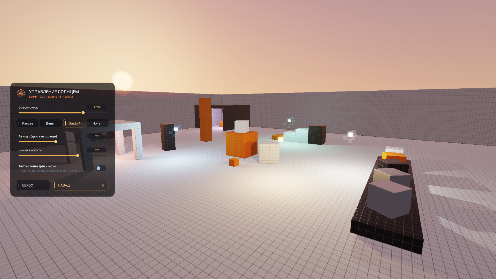

# V.O.I.D. Engine

**Virtual Objects & Interactive Dynamics** — native Rust 3D engine (`wgpu` + Rapier 3D) with deferred PBR lighting, omnidirectional point-light shadows, dynamic day/night cycle and a dev-textured lighting test room.

The **0.2 Rust runtime** lives in `crates/void-engine` and `crates/void-demo`.




## Build and run

Requirements: stable Rust (MSVC toolchain), Visual Studio Build Tools with the
Windows SDK and MSVC linker, and a DX12 or Vulkan GPU driver.

```powershell
cargo build --release --locked
cargo run --release --locked -p void-demo -- --rhi=dx12
cargo run --release --locked -p void-demo -- --rhi=vulkan
```

Executable: `target/release/void_demo.exe`.

```powershell
# Package the executable and assets into build/bin/Release:
.\tools\build-rust.ps1
.\build\bin\Release\void_demo.exe --rhi=vulkan --autostart
```

Assets are found beside the executable, in a repository ancestor, or through
`VOID_ASSETS` (an absolute path to `assets`). Settings persist as `settings.toml`
beside the executable. CLI options override saved settings for the session.

## Features

- **Rust workspace:** reusable engine library (`void-engine`) and game binary
  (`void-demo`) with pinned `Cargo.lock`; `wgpu` for native DX12/Vulkan, `winit`
  for input/windowing, Rapier 3D for physics and `rodio` for spatial audio.
- **Deferred PBR rendering:** 3-target MRT G-Buffer (`Rgba8UnormSrgb` albedo +
  metallic, `Rgba16Float` world normals + roughness, `Rgba16Float` emissive)
  with `Depth32Float` world-position reconstruction, Cook–Torrance GGX shading,
  normal-aware 12-sample SSAO, HDR bloom, edge AA, ACES tonemapping and vignette.
- **Shadows:** 4096² directional sun/moon shadow map with 16-tap rotated Poisson
  PCF, plus 512²×6 omnidirectional shadow cube arrays (`D2Array`, up to 8 point
  lights) with 8-tap rotated Poisson PCF and normal-offset bias.
- **Dynamic Sun & Day/Night Cycle:** dedicated **УПРАВЛЕНИЕ СОЛНЦЕМ** submenu
  from the main or pause menu with live time-of-day (`00:00`–`24:00`), azimuth
  and orbit-tilt sliders, Dawn/Day/Sunset/Night presets, optional real-time cycle,
  atmospheric sunset glow, procedural twinkling stars and cool moonlight.
- **Dev-Textured Lighting Test Room (`40×40 m`):** world-scale tiled `Grid_4x4`
  CC0 dev textures (`Gray`, `GrayInverted`, `Orange`, `OrangeInverted`) with
  tangent normal and roughness maps, bevelled cubes, overhang arch, shaded
  corner alcove, stepped blocks, PBR roughness/metallic calibration row and 6
  interactive colored point lights draggable in-world via `E`.
- **UI & Audio:** minimal HUD (FPS sparkline + orange controls hint), `egui`
  menu/pause/settings/sun overlays, and a 32-voice spatial HDR audio mixer.

## Controls

| Input | Action |
| --- | --- |
| `WASD` / `Shift` / `Space` | Move / sprint / jump |
| Mouse | Look |
| `E` | Grab / place targeted point light |
| Mouse Wheel | Adjust held light distance (`1.2–12.0 m`) |
| `R` / `Q` / `M` | Reset position & lights / slow motion ×0.28 / mute |
| `H` | Toggle controls hint |
| `[` / `]` | World FOV |
| `,` / `.` | Eye height |
| `F3` / `Esc` | Settings / pause |

## Verification and captures

```powershell
cargo fmt --all -- --check
cargo clippy --workspace --all-targets --locked -- -D warnings
cargo test --workspace --locked
cargo run --release --locked -p void-demo -- --selftest

# GPU smoke captures and benchmark:
.\build\bin\Release\void_demo.exe --showcase --time=13.5 --smoke=35 --screenshot=docs/rust-game.png
.\build\bin\Release\void_demo.exe --showcase --time=23.0 --smoke=35 --screenshot=docs/rust-night.png
.\build\bin\Release\void_demo.exe --sun --time=17.65 --smoke=35 --screenshot=docs/rust-sun.png
.\build\bin\Release\void_demo.exe --benchmark=100
```

`--selftest` checks gravity/settling, picking, spring movement and throwing
without opening a window. Unit tests cover audio limiting/panning, physics
collision filtering, dev-texture atlas loading and `naga` WGSL validation of
`gbuffer.wgsl`, `deferred.wgsl` and `post.wgsl`.

Other flags: `--rhi=dx12|vulkan|auto`, `--adapter=N`, `--width=N`, `--height=N`,
`--fullscreen`, `--autostart`, `--showcase`, `--settings`, `--sun`, `--time=H`,
`--novsync`, `--validation`, `--no-prompt`, `--help`.

### Measured Rust build

NVIDIA GeForce GTX 960M (Vulkan), `1600×900`, deferred PBR + 4K sun shadows +
6×512²×6 omnidirectional point-light shadows + normal-aware SSAO, 100 measured
frames after 30 warm-up frames (2026-11-21):

- `60.1 FPS` average, `55.0 FPS` 1% low, `17.17 ms` p95 frame time (`36` draws).

## Architecture

```text
crates/void-engine/src/
  render.rs       wgpu device, G-Buffer/shadow/deferred/post passes & sun math
  mesh.rs         bevelled boxes with world-scale tiled UVs, spheres, lathes
  textures.rs     DevTextures PNG atlas loader (albedo + roughness + normal)
  glb.rs          static GLB scene/accessor/embedded-image loader
  physics.rs      Rapier world, groups, rays, spring and impact stream
  scene.rs        40x40m dev-textured test room & draggable point lights
  audio.rs        spatial voices, HDR mixer, limiter and WAV loading
crates/void-demo/src/
  main.rs         event loop, player, light grabbing (E), menu/HUD routing
  ui.rs           minimal HUD, menu, settings and Sun/Day-Night control UI
  settings.rs     validated persisted TOML settings
assets/shaders/
  gbuffer.wgsl    MRT G-Buffer geometry + sun/point-light depth passes
  deferred.wgsl   deferred GGX PBR, Poisson PCF shadows, SSAO, day/night sky
  post.wgsl       HDR bloom, luma edge AA, ACES tonemapping and vignette
```

## License and credits

Proprietary source-available software, © 2026 **Mi5hlen (Михаил Однолетко)**.
See [LICENSE](LICENSE) and [COMMERCIAL_LICENSING.md](COMMERCIAL_LICENSING.md).
Third-party dependency and asset notices are in [THIRD_PARTY_NOTICES.md](THIRD_PARTY_NOTICES.md).
