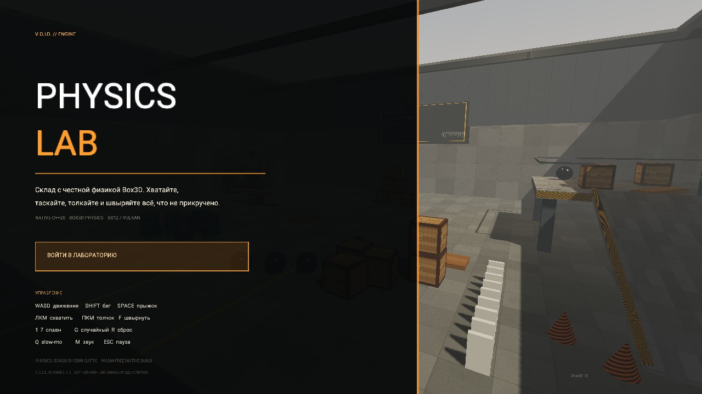
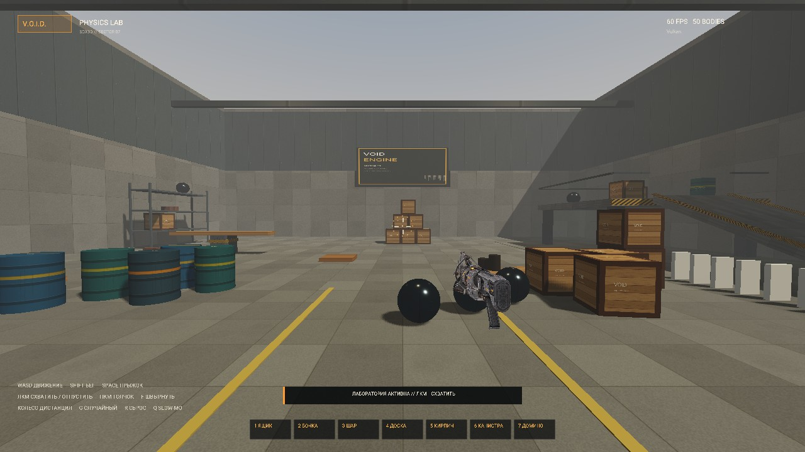
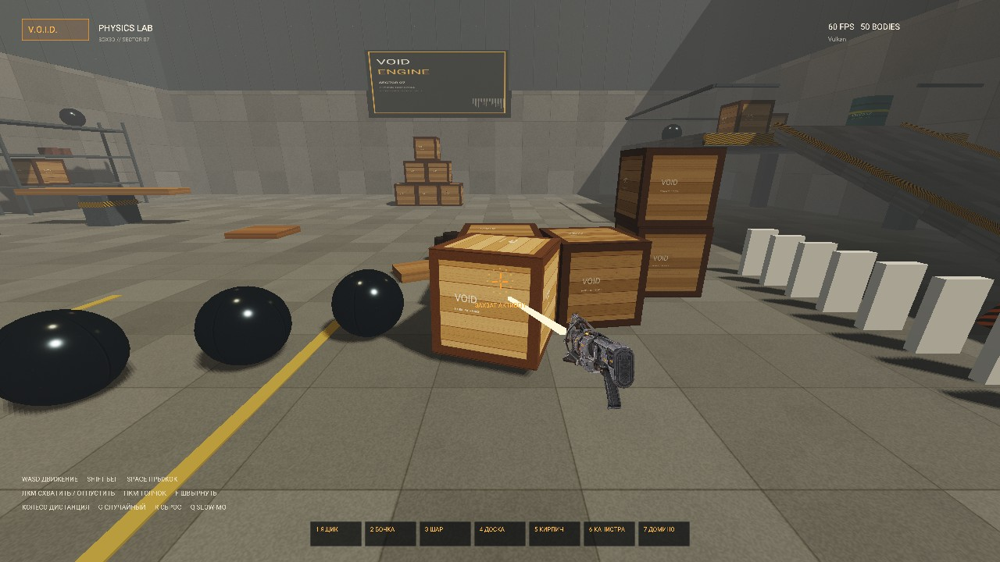

# V.O.I.D. Engine

**Virtual Objects & Interactive Dynamics**

A native C++20 game engine and physics sandbox for Windows. The first vertical slice is **PHYSICS LAB**: a warehouse full of crates, barrels and steel balls, driven by native DirectX 12 or Vulkan and Erin Catto's [Box3D](https://github.com/erincatto/box3d) physics engine.







## Status

This is a real, running **vertical slice**, not a finished commercial engine. The runtime, dual renderer backends, native physics integration and game demo work. The editor, asset pipeline, animation, scripting and production tooling are roadmap items.

- **Version:** 0.1.0
- **Platform:** Windows 10/11 x64
- **Language:** C++20, C17 (Box3D)
- **Graphics:** DirectX 12 or Vulkan, selectable at startup
- **Physics:** native Box3D 0.1.0, no WASM bridge
- **Author:** Mi5hlen (Михаил Однолетко)

## Implemented

### Rendering

- Two native backends behind one engine interface:
  - **DirectX 12** via DXGI + D3D12, root signatures, descriptor heaps, PSOs, fences, two frames in flight.
  - **Vulkan** via the system loader and `volk`, dynamic rendering, descriptor sets, explicit image barriers, swapchain recreation.
- Forward PBR-lite renderer: albedo/metal/roughness, directional sun, three point lights, ambient, exponential fog, ACES tone mapping and sRGB encoding.
- Directional shadow map rendered into an `R32_FLOAT` color target (sampled as a regular texture) with 3x3 PCF. This avoids a driver-specific depth-SRV path and behaves identically on both APIs.
- Procedural 512² material texture array: concrete, wood, crate stencil, metal, hazard stripes, barrel, sign.
- Custom 2D UI renderer and baked font atlas (Latin + Cyrillic) for the menu, HUD, hotbar, target labels and pause screen.
- Runtime backend dialog or `--rhi=dx12|vulkan`.
- Generated 48 kHz sound effects (MOSS-SoundEffect v2.0) for material impacts, grab/throw, spawning, slow motion, UI and footsteps, with a synthesized fallback if the clips are missing.
- GLB 2.0 viewmodel loader with an embedded 2048? baked base-color texture, an unlit path for baked lighting, and a dedicated high-resolution viewmodel texture binding.

### Physics and interaction

- **Box3D** integrated directly through its C17 API.
- 60 Hz simulation with 4 substeps, CCD enabled, island sleeping, contact hit events.
- Boxes, spheres, cylinders and cones (convex hulls), plus a capsule character.
- Spring-based manipulator:
  - hold **LMB** to grab and drag;
  - release to drop or throw with current momentum;
  - **RMB** to shove;
  - **F** to throw hard;
  - mouse wheel to change hold distance;
  - held shapes are filtered out of the player's collision set.
- Physics event stream drives material-specific impact sounds (wood, metal, concrete, plastic) and speed-based footsteps.
- Spawn/reset/slow-motion, 50 hand-placed props, a crate pyramid, shelves, ramp, platform, domino row, seesaw and a raised cargo deck.

### Engine layer

- Frame renderer abstraction, camera, mesh factory, procedural texture factory, UI/font layer, audio synthesizer, physics wrapper.
- Public headers under `include/void/`; demo game code under `src/demo/`.
- Static MSVC runtime, one self-contained demo executable plus assets.
- CMake 3.24+ build with pinned FetchContent dependencies.
- `--selftest` smoke test that exercises picking, grabbing, spring movement, throwing, reset and spawning.
- Logs go to `void.log` beside the executable.

## Controls

| Input | Action |
| --- | --- |
| `WASD` | move |
| `Shift` | sprint |
| `Space` | jump |
| Mouse | look |
| `LMB` hold | grab / release |
| `RMB` | shove (or throw held object) |
| `F` | throw held object |
| Wheel | change grab distance |
| `1`–`7` | spawn crate, barrel, sphere, plank, brick, can, domino |
| `G` | spawn random prop |
| `R` | reset scene |
| `Q` | slow motion ×0.28 |
| `M` | mute audio |
| `Esc` | pause / release mouse |

## Build

### Requirements

- Windows 10 or 11 x64
- Visual Studio 2022 with the **Desktop development with C++** workload
- CMake **3.24+**
- Windows 10/11 SDK (D3D12 + `dxc.exe`)
- Git (CMake fetches dependencies)
- Internet access on the first configure

A Vulkan SDK is **not required** to build or run the Vulkan backend. Vulkan headers and `volk` are fetched by CMake; the runtime loader comes from the GPU driver. Install the LunarG Vulkan SDK only if you want validation layers.

DXC bundled with some Windows SDKs lacks SPIR-V codegen. The build first looks for `tools/dxc/bin/x64/dxc.exe`; if it is missing, CMake downloads the pinned standalone DXC release into the build tree.

### Configure and build

```powershell
cmake -S . -B build -G "Visual Studio 17 2022" -A x64
cmake --build build --config Release --parallel
```

The executable is `build/bin/Release/void_demo.exe`; assets and compiled shaders are copied next to it.

### Run

```powershell
.\build\bin\Release\void_demo.exe
```

On startup, choose DirectX 12 or Vulkan. The choice can be bypassed:

```powershell
.\build\bin\Release\void_demo.exe --rhi=dx12
.\build\bin\Release\void_demo.exe --rhi=vulkan
```

Useful flags:

| Flag | Meaning |
| --- | --- |
| `--rhi=dx12\|vulkan\|auto` | select backend |
| `--adapter=N` | select an adapter index |
| `--validation` | enable D3D12 debug layer (Vulkan validation if installed) |
| `--novsync` | disable vsync where supported |
| `--width=`, `--height=` | window size |
| `--fullscreen` | fullscreen window |
| `--no-prompt` | skip the backend dialog |
| `--autostart` | skip the menu |
| `--showcase` | start grabbed onto a crate (screenshot mode) |
| `--selftest` | run the physics/input smoke test and exit |

Logs are written to `void.log` in the executable directory. The demo is a GUI subsystem executable; use the log file when launching without a console.

## Sound effects

The shipped clips in `assets/audio/sfx/` were generated with
[MOSS-SoundEffect v2.0](https://huggingface.co/OpenMOSS-Team/MOSS-SoundEffect-v2.0)
(Apache-2.0). Prompts, durations and seeds live in `tools/generate_sfx.py`, so the
set can be regenerated with either the official Hugging Face Space or a local
checkout of the [MOSS-TTS](https://github.com/OpenMOSS/MOSS-TTS) pipeline:

```powershell
python tools/generate_sfx.py --backend space --hf-token $env:HF_TOKEN
python tools/generate_sfx.py --backend local --moss-dir C:/MOSS-TTS --device cpu
```

If a clip is missing, AudioKit falls back to a small procedural synthesizer, so
the demo still has sound on a bare checkout.

## Architecture

```text
include/void/
  audio/        AudioKit
  core/         Types, logging, paths
  physics/      PhysicsWorld (Box3D C API wrapper)
  platform/     SDL3 window + input
  render/       Camera, mesh factory, procedural textures, GLB loader
  rhi/          Backend interface and stats
  ui/           Bitmap font + UI vertex list

src/
  audio/        SDL3 audio stream synthesizer
  core/
  demo/         PHYSICS LAB game layer
  physics/      Box3D bodies, shapes, filters, raycasts, hit events
  platform/
  render/       meshes, textures
  rhi/dx12/     native D3D12 backend
  rhi/vulkan/   native Vulkan backend
  ui/           stb_truetype atlas + text layout
```

The **engine** owns platform, renderer, physics, UI and audio facilities. The **demo** owns scene layout, gameplay rules and the warehouse. The demo is intentionally a separate target (`void_demo`) from the engine library (`void_engine`).

### Physics notes

- Bodies are tagged with numeric user data; Box3D contact hit events are mapped back to props for material-specific impact audio.
- Shapes use explicit category/mask filters. While an object is held, the player category is removed from its mask.
- Player movement uses a dynamic capsule with angular motion locks. This lets the player push crates physically. Box3D's experimental character mover is not used yet; it is on the roadmap for precise platforming.
- Raycasts exclude the player category, so the crosshair only targets the world and props.

### Renderer notes

- The same HLSL sources compile with DXC to DXIL and SPIR-V; entry points are `VSMain` / `PSMain`.
- The GLB loader handles static meshes with embedded PNG base-color textures. It deliberately ignores animation, skinning and compressed-texture extensions; the manipulator viewmodel is rendered with a dedicated 2048? texture and an unlit path because its atlas already contains baked lighting.
- Vulkan uses dynamic rendering and a negative viewport height so both backends share the same world-space matrices and UI projection.
- The shadow pass renders depth into a floating-point color target; the scene samples it as an ordinary `Texture2D`, avoiding a known Intel depth-SRV issue.
- UI lives in screen pixels and is uploaded into a dynamic vertex buffer each frame.

## Performance

Measured on the development laptop:

- **DirectX 12, Intel HD Graphics 530, 1280×720:** 59–60 FPS with 50 props.
- **Vulkan, NVIDIA GTX 960M, 1280×720:** 60 FPS.
- ~95 draw calls and ~30k triangles for the whole demo.
- 2 frames in flight, 2048² shadow map, 8-layer 512² texture array.

## Roadmap

- Scene/ECS layer with serialization and a proper asset pipeline (glTF, texture compression, mips).
- Editor and entity inspector.
- Box3D character mover with slope/step handling.
- Job system and multithreaded command recording.
- Animation, scripting and networking.
- HDR/MSAA/post-processing and a render graph.
- Linux/Vulkan target and automated CI screenshots.
- Better material/lighting authoring; the current demo uses procedural assets to stay dependency-free.

## License

V.O.I.D. Engine is **proprietary source-available software**. Copyright © 2026 Mi5hlen (Михаил Однолетко). All rights reserved. Evaluation and development of the engine are allowed under the terms in [LICENSE](LICENSE); commercial use, distribution or sublicensing requires a separate written license from the author.

Third-party components are used under permissive licenses and are listed in [THIRD_PARTY_NOTICES.md](THIRD_PARTY_NOTICES.md). The bundled Roboto font is licensed under the Apache License 2.0; see `assets/fonts/LICENSE.txt`.

For commercial licensing, contact the author through the GitHub repository.

## Credits

- **Engine and demo:** Mi5hlen (Михаил Однолетко)
- **Physics:** Box3D by Erin Catto, MIT
- **Window/input/audio:** SDL3, zlib
- **Math:** GLM, MIT
- **Vulkan loading:** volk, MIT; Vulkan-Headers, Apache-2.0
- **Font rasterization:** stb_truetype, MIT; Roboto, Apache-2.0
- **Shader compiler:** DirectXShaderCompiler, build-time tool
- **Sound effects:** MOSS-SoundEffect v2.0 by the OpenMOSS team, Apache-2.0
- Inspired by the Half-Life 2 physics demonstration at E3 2003.
