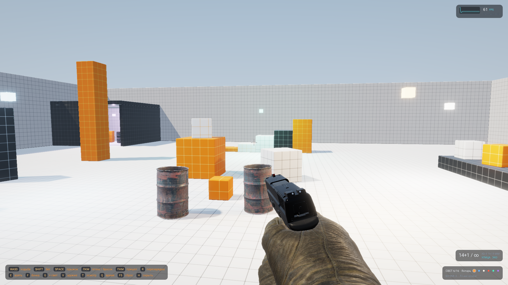
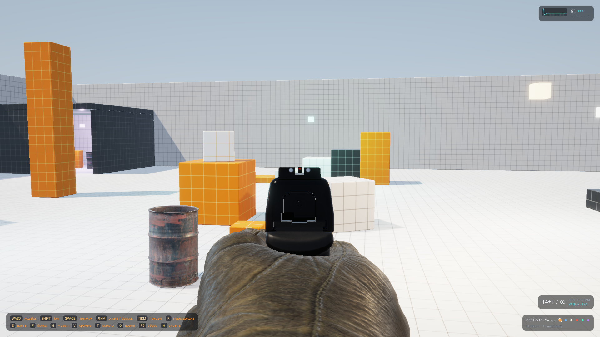
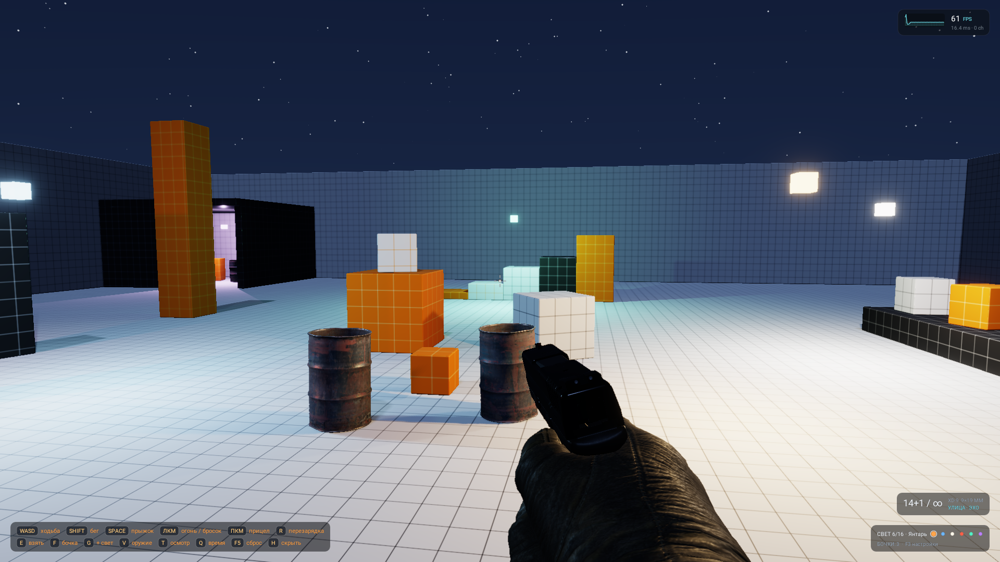

# V.O.I.D. Engine

**Virtual Objects & Interactive Dynamics** — native Rust 3D engine (`wgpu` + Rapier 3D) with deferred PBR lighting, omnidirectional point-light shadows, dynamic day/night cycle and a dev-textured lighting test room.

The **0.2 Rust runtime** lives in `crates/void-engine` and `crates/void-demo`.








## Build and run

Requirements: stable Rust (MSVC toolchain), Visual Studio Build Tools with the
Windows SDK and MSVC linker, and a DX12 or Vulkan GPU driver.

```powershell
cargo build --release --locked
cargo run --release --locked -p void-demo -- --rhi=dx12
cargo run --release --locked -p void-demo -- --rhi=vulkan
```

Executable: `target/release/void_demo.exe`.

```powershell
# Package the executable and assets into build/bin/Release:
.\tools\build-rust.ps1
.\build\bin\Release\void_demo.exe --rhi=vulkan --autostart
```

Assets are found beside the executable, in a repository ancestor, or through
`VOID_ASSETS` (an absolute path to `assets`). Settings persist as `settings.toml`
beside the executable. CLI options override saved settings for the session.

## Features

- **Rust workspace:** reusable engine library (`void-engine`) and game binary
  (`void-demo`) with pinned `Cargo.lock`; `wgpu` for native DX12/Vulkan, `winit`
  for input/windowing, Rapier 3D for physics and `rodio` for spatial audio.
- **Deferred PBR rendering:** 3-target MRT G-Buffer (`Rgba8UnormSrgb` albedo +
  metallic, `Rgba16Float` world normals + roughness, `Rgba16Float` emissive)
  with `Depth32Float` world-position reconstruction, Cook–Torrance GGX shading,
  normal-aware 12-sample SSAO, HDR bloom, edge AA, ACES tonemapping and vignette.
- **Shadows:** 4096² directional sun/moon shadow map with 16-tap rotated Poisson
  PCF, plus 512²×6 omnidirectional shadow cube arrays (`D2Array`, up to 8 point
  lights) with 8-tap rotated Poisson PCF and normal-offset bias.
- **Dynamic Sun & Day/Night Cycle:** dedicated **УПРАВЛЕНИЕ СОЛНЦЕМ** submenu
  from the main or pause menu with live time-of-day (`00:00`–`24:00`), azimuth
  and orbit-tilt sliders, Dawn/Day/Sunset/Night presets, optional real-time cycle,
  atmospheric sunset glow, procedural twinkling stars and cool moonlight.
- **Dev-Textured Lighting Test Room (`30×30 m`, 1:1 SI Metric):** world-scale
  tiled `Grid_4x4` CC0 dev textures (`1.0 m` tile = `0.25 m` per cell) with
  tangent normal and roughness maps, real-world-proportioned architectural
  blocks (`0.20 m` stair riser through `1.80 m` human height gauge, `2.10 m`
  door monolith, `2.80 m` ceiling alcove), ISO 200 L steel barrel props
  (`Ø 0.585×0.880 m`, `20 kg`) and 6 interactive point lights draggable via `E`.
- **First-Person Pistol & Ballistics:** rigged `fps_pistol.glb` (`viewmodel::RiggedModel`) with PBR arm/pistol maps, isolated foreground viewmodel depth pass, skeletal idle/walk/fire/reload animations, Aim Down Sights (`RMB`), tactical `15+1` & empty reload with slide lock-back, procedural sway/tilt/sprint cant, spring-damper recoil & trauma screen shake, brass shell ejection, muzzle flash light, local-space bullet-hole decals (`DECAL_CONCRETE`, `DECAL_METAL`, `DECAL_WOOD`), surface-specific impact VFX, and MW2019-inspired indoor/outdoor ray-probed gunshot acoustics with wall slapback echoes.
- **Gamepad Support (`void_engine::input`):** plug-and-play `gilrs` controller support (XInput / DualSense / HID) with radial deadzone, precision aim response curve, hair-trigger `LT`/`RT` hysteresis, force-feedback rumble on firing/landings/grabs, auto-switching HUD prompts, and a dedicated **ГЕЙМПАД** settings tab.
- **UI & Audio:** minimal HUD (FPS sparkline, ammo & acoustic zone pill, dynamic reticle & hitmarker, orange controls hint), `egui` menu/pause/settings/sun overlays, a 32-voice spatial HDR audio mixer with delayed/filtered echo voices, and surface-aware footsteps (`18` surfaces × `5` variations) driven by a phase-locked gait and head-bob controller (`locomotion::FootstepGait`).

## Coordinate system & real-world scale

V.O.I.D. uses a **1:1 SI metric** coordinate system (`1.0` unit = `1.0 m`) in a
right-handed Y-up space (`+X` right, `+Y` up, `-Z` forward, ground datum `Y = 0`,
gravity `-9.80665 m/s²`), defined centrally in `crates/void-engine/src/units.rs`.

| Domain | Canonical Values | Ratio to Real World / Human (`1.80 m`) |
| --- | --- | --- |
| **Player (`units::human`)** | `1.80 m` capsule (`r = 0.30 m`), eyes `1.65 m`, `78 kg` | `1:1` standing adult (`3.6` / `6.4 m/s`, reach `3.5 m`) |
| **Camera (`units::camera`)** | `Hor+` `90°` HFOV (`70–120°`), near/far `0.06..160 m`, `±85°` pitch | `58.7°` VFOV (`18 mm` eq.), floor POV `1.50–1.74 m`, `5×0.022°` mouse |
| **World (`units::world`)** | `30×30 m` hall, `4.50 m` walls (`0.25 m` thick), `1.0 m` tile | `2.80 m` room ceiling, `2.10 m` door, `0.45 m` bench, `0.90 m` counter |
| **Props (`units::props`)** | `old_tin_barrel` (`Ø 0.585 × 0.880 m`, `20 kg`) | `1:1` ISO 15750-2 200 L steel drum (`0.49×` human height) |

See [docs/scale_and_coordinates.md](docs/scale_and_coordinates.md) for the full
specification of axes, unit conversions, mesh normalization, and scene ratios.

## Controls

| Input | Action |
| --- | --- |
| `WASD` / `Shift` / `Space` | Move / sprint / jump |
| Mouse | Look |
| `E` | Grab / release targeted point light or barrel |
| `LMB` | Fire pistol (or throw held barrel / place held point light) |
| `RMB` | Aim down sights (ADS) |
| `R` / `V` / `T` | Reload (`15+1`) / holster-draw pistol / inspect weapon |
| `F` | Spawn `old-tin-barrel` prop in front of camera |
| `G` / `L` | Place dynamic point light (selected preset, up to 16) |
| `X` / `Delete` | Remove targeted or held point light / barrel |
| `1`–`6` / `C` | Select / cycle dynamic light color preset |
| Mouse Wheel | Adjust held light or barrel distance |
| `F5` / `Backspace` / `Q` / `M` | Reset position, props & lights / slow motion ×0.28 / mute |
| Gamepad (`LS` / `RS` / `LT` / `RT`) | Move (`L3` sprint) / Look (`R3` inspect) / ADS / Fire or throw |
| Gamepad (`A` / `X` / `Y` / `B`) | Jump / Reload / Grab-release / Holster-draw |
| Gamepad (`LB` / `RB` / `D-Pad` / `Start`) | Slow-mo / Spawn barrel / Lights & remove / Pause |
| `H` | Toggle controls hint |
| `[` / `]` | Horizontal FOV (`Hor+` 16:9, `70°–120°`) |
| `,` / `.` | Standing POV eye height (`1.50–1.74 m` from floor) |
| `F3` / `Esc` | Settings / pause |

## Verification and captures

```powershell
cargo fmt --all -- --check
cargo clippy --workspace --all-targets --locked -- -D warnings
cargo test --workspace --locked
cargo run --release --locked -p void-demo -- --selftest

# GPU smoke captures and benchmark:
.\build\bin\Release\void_demo.exe --showcase --time=13.5 --smoke=35 --screenshot=docs/rust-game.png
.\build\bin\Release\void_demo.exe --showcase --time=23.0 --smoke=35 --screenshot=docs/rust-night.png
.\build\bin\Release\void_demo.exe --sun --time=17.65 --smoke=35 --screenshot=docs/rust-sun.png
.\build\bin\Release\void_demo.exe --benchmark=100
```

`--selftest` checks gravity/settling, picking, spring movement and throwing
without opening a window. Unit tests cover audio limiting/panning, physics
collision filtering, dev-texture atlas loading and `naga` WGSL validation of
`gbuffer.wgsl`, `deferred.wgsl` and `post.wgsl`.

Other flags: `--rhi=dx12|vulkan|auto`, `--adapter=N`, `--width=N`, `--height=N`,
`--fullscreen`, `--autostart`, `--showcase`, `--settings`, `--sun`, `--time=H`,
`--novsync`, `--validation`, `--no-prompt`, `--help`.

### Measured Rust build

NVIDIA GeForce GTX 960M (Vulkan), `1600×900`, deferred PBR + 4K sun shadows +
6×512²×6 omnidirectional point-light shadows + normal-aware SSAO, 100 measured
frames after 30 warm-up frames (2026-11-21):

- `60.1 FPS` average, `55.0 FPS` 1% low, `17.17 ms` p95 frame time (`36` draws).

## Architecture

```text
crates/void-engine/src/
  units.rs        1:1 SI metric scale, RH Y-up coordinates & human/world/prop ratios
  render.rs       wgpu device, G-Buffer/shadow/deferred/post passes & sun math
  mesh.rs         bevelled boxes with world-scale tiled UVs, spheres, lathes
  textures.rs     DevTextures PNG atlas loader (albedo + roughness + normal)
  glb.rs          static GLB scene/accessor/embedded-image loader
  physics.rs      Rapier world, groups, rays, spring and impact stream
  scene.rs        30x30m real-world-scaled test hall, ISO barrel props & point lights
  locomotion.rs   distance-driven gait phase, synced head-bob & landing step triggers
  audio.rs        spatial voices, HDR mixer, limiter, surface footsteps & WAV loading
crates/void-demo/src/
  main.rs         event loop, player, light grabbing (E), menu/HUD routing
  ui.rs           minimal HUD, menu, settings and Sun/Day-Night control UI
  settings.rs     validated persisted TOML settings
assets/shaders/
  gbuffer.wgsl    MRT G-Buffer geometry + sun/point-light depth passes
  deferred.wgsl   deferred GGX PBR, Poisson PCF shadows, SSAO, day/night sky
  bloom.wgsl      5-mip Karis-prefiltered downsample + 9-tap tent upsample bloom
  post.wgsl       bloom composite, luma edge AA, ACES tonemapping and vignette
```

## License and credits

Proprietary source-available software, © 2026 **Mi5hlen (Михаил Однолетко)**.
See [LICENSE](LICENSE) and [COMMERCIAL_LICENSING.md](COMMERCIAL_LICENSING.md).
Third-party dependency and asset notices are in [THIRD_PARTY_NOTICES.md](THIRD_PARTY_NOTICES.md).
